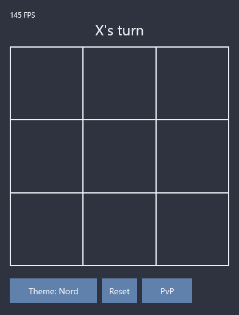
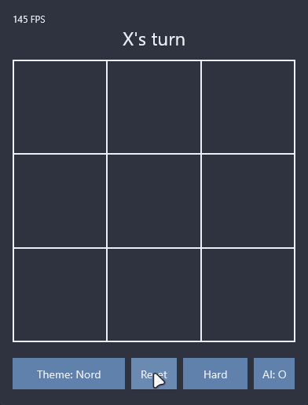

# GameTTT

Tic-tac-toe for the desktop, written in Kotlin with Compose Multiplatform. You can play against a friend on the same machine or against one of three AI levels. The hardest level runs minimax and can't be beaten.

I built it to learn Compose for Desktop. It's finished, and I'm not planning more features.



## Download

Grab `GameTTT-1.0.jar` from [Releases](https://github.com/Noamm-Dev/GameTTT/releases/latest) and run it:

```sh
java -jar GameTTT-1.0.jar
```

You need **Java 25 or newer**. A single jar ships the native libraries for Windows, Linux and macOS (x64 and arm64).

## Playing

The buttons under the board are the only controls. Theme switches between Default (light) and Nord (dark), Reset clears the board, and the mode button cycles through PvP, Easy, Normal and Hard. Outside PvP, the `AI: X` / `AI: O` button picks which side the computer plays. X always moves first, so with the AI on X it makes the opening move.

| Mode   | What the computer does                                         |
|--------|----------------------------------------------------------------|
| PvP    | Nothing. Two people take turns.                                |
| Easy   | Picks a random empty cell.                                     |
| Normal | Plays the best move, except 30% of the time it picks at random. |
| Hard   | Full minimax. The best you can do is a draw.                   |




## Building from source

Gradle downloads a JDK 25 toolchain on its own if you don't have one. Gradle itself needs JDK 17+ to start.

```sh
./gradlew run                          # play straight from source
./gradlew test                         # game logic and AI tests
./gradlew packageUberJarForCurrentOS   # writes build/compose/jars/GameTTT-1.0.jar
```

On Windows, use `gradlew.bat` instead of `./gradlew`.

## License

[CC0 1.0](LICENSE). Public domain, so do whatever you want with it.
